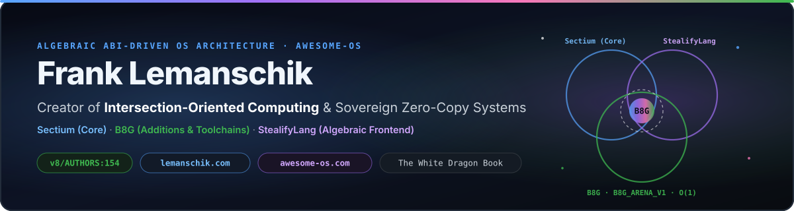
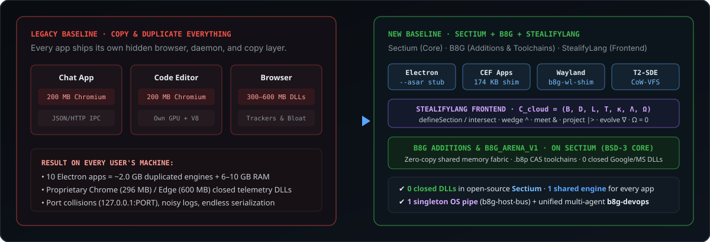

  

  <a href="https://lemanschik.com"><strong>lemanschik.com</strong></a> ·
  <a href="https://awesome-os.com"><strong>awesome-os.com</strong></a> ·
  <a href="mailto:frank@dspeed.eu"><strong>frank@dspeed.eu</strong></a>

---

## The New Baseline: Algebraic ABI-Driven OS Architecture

Modern computers are **100× faster** than the machines we grew up on — yet opening a chat app, a code editor, and a web browser still eats **10 GB of RAM**, **2+ GB of duplicated disk space**, and spins up your fans.

**Why?** Because the software industry normalized **copying everything**:
- Every Electron app ships its own **~200 MB private copy of Chromium**.
- Every proprietary browser piles **300–600 MB of closed telemetry, auto-updaters, shopping sidebars, and hidden AI DLLs** on top of open-source Chromium.
- Every microservice and local tool binds random `127.0.0.1` ports, copies JSON back and forth, and dumps developer warnings into the laps of normal users.

**That era is over.**

I am the creator of **Algebraic ABI-Driven OS Architecture** *(Intersection-Oriented Computing)* — structured as one coherent **3-pillar stack**:
- **`Sectium`** — Core open-source BSD-3 Chromium engine & main dependency/fundament (`0` closed Google/Microsoft DLLs).
- **`B8G`** — Additions, OS/ABI runtime, zero-copy `B8G_ARENA_V1`, strangler-fig shims, and `.b8p` CAS toolchains running on `Sectium`.
- **`StealifyLang`** — Algebraic universal language helper & compiler frontend (`defineSection`, `intersect`, `wedge ^`, `meet &`, `project |>`, `evolve ∇`, 7-Tuple `C_cloud`).

Instead of piling more frameworks on top of broken abstractions, we treat the **binary boundary (ABI) and shared memory layout** as the primary, mathematically verified source of truth.

  

---

## Honest Lineage — Standing on Giants, Going One Level Deeper

Real systems engineering never exaggerates. Binary-first boundaries have respected predecessors:
- **Microsoft COM / WinRT** *(1993+)* proved language-agnostic binary vtable ABIs.
- **Google Fuchsia / Zircon FIDL** *(2016+)* proved capability-gated, ABI-first IPC.
- **WASI Component Model / WIT** *(2022+)* proved canonical cross-language sandbox ABIs.
- **Apache Arrow, Cap'n Proto & seL4** proved zero-copy layouts and formal capability tokens.

**What is genuinely first-of-its-kind in `Sectium` + `B8G` + `StealifyLang`** is unifying all three of these breakthroughs into **one coherent, algebraic operating fabric**:

### 1. Zero-Copy *Intersection-Oriented* ABI (`StealifyLang` + `B8G`)
Even the best legacy ABIs still *serialize and copy messages* across walls. Using **`StealifyLang`** over **`B8G`**, overlapping apps and OS services literally **intersect** (`defineSection` / `intersect`) onto the **exact same 64-byte-aligned `B8G_ARENA_V1` memory slots** using four simple algebraic operators:
- **`wedge (^)`** — Composes orthogonal sections (field collisions are impossible by construction).
- **`meet (&)`** — Monotonically narrows security capabilities (authority can *only* shrink, never escalate).
- **`project (|>)`** — Separates full-speed internal execution from paced legacy OS host boundaries.
- **`evolve (∇)`** — Advances Copy-on-Write epochs with **O(1) instant rollback**.

### 2. The 7-Tuple Execution Context Algebra & Zero-Cost Consumer Mode
Every window, service, and build runs inside one formal `StealifyLang` contract enforced by `B8G`:

> **`C_cloud = (Boundary, Display, Lifetime, Transport, Capability, Locality, Persona)`**

This single equation eliminates whole categories of real-world bugs before code even runs:
- **No invisible GUIs:** An operation requiring a visible foreground window cannot silently pretend to succeed from a headless background job.
- **No `EADDRINUSE` / port chaos:** Local tools share **one singleton OS Named Pipe / Unix Socket** (`b8g-host-bus`), never random loopback HTTP servers.
- **No accidental cloud leaks:** Private data is mathematically pinned inside your local machine or LAN (`Locality <= lan-peer`).
- **Zero-Cost Consumer Mode (`Persona = consumer ⇒ ∅`):** Normal users pay **0 CPU, 0 RAM, and 0 console noise** for telemetry or developer warnings. Engineers and autonomous AI agents attach orthogonally to **one centralized `b8g-devops` hub** that routes P0–P3 emergencies to specialist worker units with zero duplicate firefighting.

### 3. Full-Stack Strangler-Fig Virtualization (`B8G` Additions on `Sectium` Core)
You do not have to rewrite the world on day one. **`B8G`** intercepts the cleanest binary seam so existing software runs on **one shared open-source `Sectium` engine**:
- **Installed Electron Apps:** Read `resources/app.asar` directly (`b8g-electron --asar`) with **zero mutation** of signed installs — turning 10 × 200 MB apps into **1 shared runtime**.
- **Installed CEF Apps:** Drop-in **`174 KB`** C-ABI `libcef.dll` shim (`b8g-cef-shim`) replacing ~200 MB embedded browsers.
- **Native GUI Toolkits & Legacy Binaries:** Zero-copy Wayland-to-Arena shim (`b8g-wl-shim`), 4-tier Win64/DOS/.NET binary boxing, and **7-arch T2-SDE CoW-VFS overlays** (`t2-sde-b8g`) with `web-posix` + O(1) rollback.

---

## Why This Clicks Instantly: Exact Categorized Delta (Chromium vs. Chrome vs. Edge vs. Sectium)

People always ask *"How much proprietary stuff is really piled on top of open-source Chromium?"*

| Category | Stock **Chromium** (Open Source) | **Google Chrome** Additions (`is_chrome_branded`) | **Microsoft Edge** Additions (Closed Fork) | Does **Sectium** Need It? |
| :--- | :--- | :--- | :--- | :--- |
| **1. Media Codecs** | Open codecs only (VP8/VP9, AV1, Opus, Vorbis, FLAC, Theora) | Proprietary `proprietary_codecs=true` (H.264, AAC, HEVC/H.265 patent-licensed builds) | H.264, AAC, HEVC (via Windows Media Foundation hardware decode) | **Optional** (use OS HW decode / OpenH264 — zero licensing lock-in) |
| **2. DRM / EME** | EME API shell only (no CDM binary) | **Widevine CDM** (closed binary component) | **PlayReady CDM** (hardware SL3000 4K Netflix) + **Widevine CDM** | **Opt-in user plugin only** (never baked into core OS) |
| **3. Auto-Updater** | None | **Omaha / `GoogleUpdate` (`ChromeUpdater`)** background service | **`MicrosoftEdgeUpdate`** background service | **NO** — replaced by `.b8p` CAS + `t2-sde-b8g` CoW epochs |
| **4. Identity & Sync** | Sync protocol code (no keys) | Google OAuth API keys, Chrome Sync, Google Password Manager, Payment/Autofill cloud | Microsoft Account (MSA/Entra ID) Sync, Wallet, Workspaces | **NO** — replaced by sovereign `CapabilityToken` + local CAS |
| **5. Telemetry & Crash** | Crashpad client (disabled) | **UMA / UKM** metrics, **RLZ** attribution tracking, Google Crash Reporting | Microsoft Diagnostic Data, SmartScreen telemetry, Watson crash reporting | **NO** — replaced by opt-in `intersections/b8g-devops` (`Ω = consumer ⇒ ∅`) |
| **6. Security Services** | Safe Browsing client (no keys) | **Google Safe Browsing** (real-time URL/phishing/download scanning), Enhanced Protection | **Microsoft Defender SmartScreen** + Super Duper Secure Mode (V8 JIT toggle) | **Optional** (local capability/sandbox + `B8G` admissibility gates) |
| **7. AI & On-Device Models** | `optimization_guide` plumbing only | **Gemini Nano** on-device model download, Chrome AI writing/tab-organizer, Google Lens | **Copilot Sidebar**, Bing Shopping/Coupons, Read Aloud (Azure TTS), Collections | **NO** — replaced by sovereign `intersections/b8g-moe-gate` (local MoE / AtlasKV) |
| **8. OS & Embedder Surfaces** | Standard desktop binary | Google Chrome branding, ChromeOS Ash integration, Google Print/Cast (`MediaRouter` Cast SDK) | **WebView2** system runtime, IE Mode (Trident COM bridge), Vertical Tabs, Split Screen, Sleeping Tabs | **NO** — replaced by `b8g-electron` + `b8g-cef-shim` + `b8g-wl-shim` |
| **9. Enterprise / Policy** | Base Policy engine | Chrome Enterprise Core / Cloud Management (CBCM) | Microsoft Intune / Group Policy / Entra ID Conditional Access | **NO** — replaced by 7-Tuple `C_cloud` CISO Sovereignty Gate |

**Verified Windows 11 binary footprint (same machine):** Google Chrome `157.0.8103.79` = **296.10 MB** `chrome.dll` + 33.86 MB closed AI DLLs (`25.06 MB` `resources.pak`) · Microsoft Edge `158.0.4370.33` = **599.88 MB** `msedge.dll + msedge_renderer.dll` (`35.62 MB` `resources.pak`) · **`Sectium`** (Open Source · 0 Closed DLLs) = **0 closed DLLs** (`21.19 MB` `resources.pak`).

When you see **599.88 MB** of closed browser DLLs next to **zero**, the entire philosophy clicks in five seconds: **software does not have to be heavy, opaque, or wasteful.**

---

## Books & Projects

- **`Sectium` + `B8G` + `StealifyLang`** — Sovereign 3-pillar stack: open-source BSD-3 Chromium core (`Sectium`), zero-copy OS/ABI runtime & CAS toolchains (`B8G`), and algebraic language frontend (`StealifyLang`) → [awesome-os.com](https://awesome-os.com)
- **The White Dragon Book** — Engineering manifesto on Post-Neumann compilation, zero-header ABIs, and strangler-fig binary boundaries.
- **The Little White Dragon & The Honest Machine** — Illustrated storybook starring **Lumi** (the Little White Dragon mascot & storybook guide), teaching kids (ages 8–14) how computers *really* work underneath the shiny boxes.
- **V8 Contributor** — Listed in Google V8 `AUTHORS` (`v8/AUTHORS:154`).

---

  <em>„Nunquam ante, numquam iterum“</em> — Pay a hard architectural cost once, crystallize it behind an honest boundary, and never pay it again.

